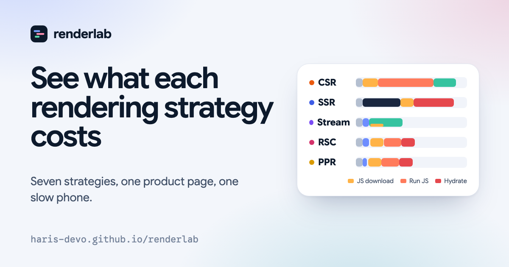

# renderlab

**An interactive lab for frontend rendering strategies.** Seven ways to put the same product page on a screen, one slow phone, one network you control. Drag the timeline and see what each choice costs.

**Live: https://haris-devo.github.io/renderlab/**



## What is inside

| Section | What you do |
| --- | --- |
| **The lab** | Pick CSR, SSG, ISR, SSR, streaming SSR, Server Components or partial prerendering. Change the page, network, device, data latency and bundle size. Scrub a waterfall while a mock browser repaints. Tap the button before the page has hydrated and see it ignored. Compare any two strategies side by side. Every setup is a shareable link. |
| **How each one works** | Step through the request as an animated diagram. Best fits, anti-patterns, gotchas, and Next.js 15 and 16 code for each. A side-by-side trade-off matrix. |
| **The cache clock** | Run an ISR cache in fast-forward. Publish in a CMS, send visitors, trigger on-demand revalidation, and see why `revalidate: 60` does not mean "fresh every 60 seconds". |
| **Streaming and PPR** | Wrap regions in Suspense, mark them dynamic, and watch the HTTP response arrive chunk by chunk. Break the build the way Next.js would. |
| **Boundaries** | Move `"use client"` around a real component tree. See which imports get dragged into the bundle and fix it by passing children. |
| **Decide** | Seven questions that rank the strategies, with the reasons for and against each. |
| **Interview round** | Twelve scenarios in the style of frontend system design rounds, with a follow-up question after each. |

## How the numbers are made

The lab is a timing model, not a browser. It is a handful of explicit rules (a cold connection costs two round trips, running JavaScript costs 1.4 ms per KB on a fast desktop, the first paint happens after about 14 KB of HTML, and so on), all in [`src/engine/simulate.ts`](src/engine/simulate.ts). It is built to move the way real measurements move, and it is tested for that: for example, a slower network or CPU never makes any strategy faster, and streaming improves first paint without changing when the main data arrives.

Use it to see why one strategy beats another. Use Lighthouse or WebPageTest for a verdict on your own site.

The engines for the ISR cache, the streaming planner, the Server Component boundary model and the decision ranking live next to it in `src/engine/`, each with tests.

## Run it

```bash
npm install
npm run dev        # http://localhost:5173
npm test           # engine tests
npm run build      # typecheck, build, prerender
npm run preview    # serves the built site at /renderlab/
```

## It practises what it teaches

The deployed page is **prerendered at build time and hydrated** in the browser: static generation with hydration, the same approach the lab describes. `npm run build` builds the client bundle, builds a server entry, renders the app to a string and writes it into `dist/index.html` (see [`scripts/prerender.mjs`](scripts/prerender.mjs)). The whole site is about 116 KB of gzipped JavaScript and self-hosts its fonts.

## Notes

- **Stack:** React 19, TypeScript, Vite. No UI or animation library.
- **Type:** Google Sans Flex and Google Sans Code, both under the SIL Open Font License, self-hosted from `public/fonts`.
- **Social card:** `public/og.png` is rendered from [`scripts/og.html`](scripts/og.html).
- **Code samples** were checked against the Next.js 16 documentation, including `cacheComponents`, `'use cache'`, `cacheLife`, `cacheTag` and `updateTag`.

## Licence

MIT. See [LICENSE](LICENSE).
